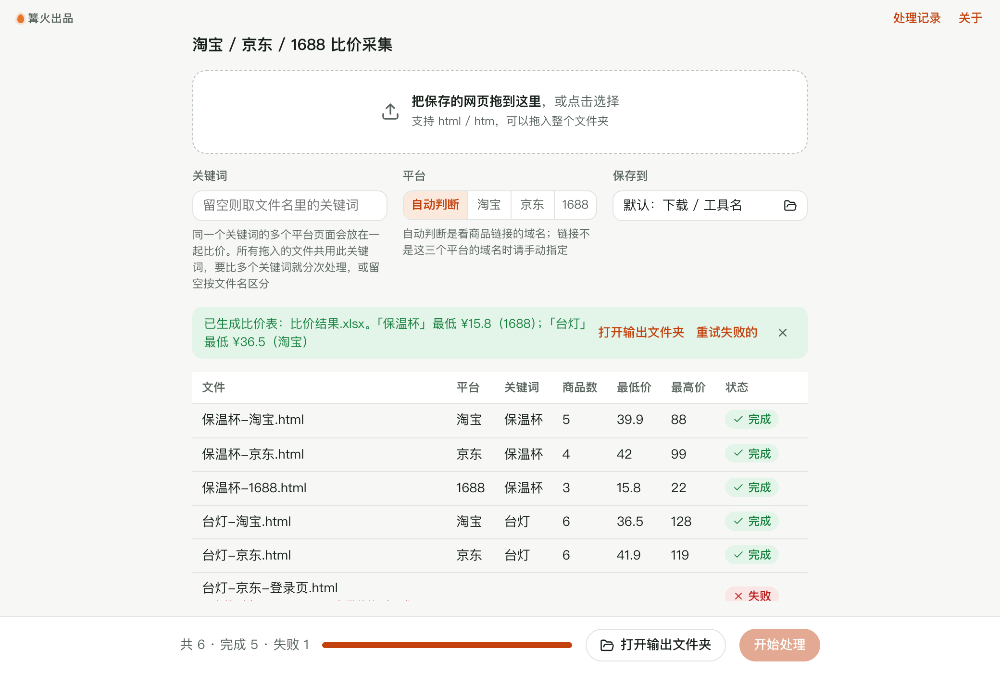

# 淘宝 / 京东 / 1688 比价采集

> 篝火出品 · 收录于篝火 App 应用区

> [!WARNING]
> 本工具涉及第三方平台的自动化或内容获取，存在账号被限制、违反平台规则或侵权的风险，仅供学习研究。请遵守平台规则与法律法规，使用后果自负。
>
> 本工具**只整理你自己在浏览器里打开并保存下来的页面**：不访问平台、不登录、不读取也不保存任何 cookie、不自动翻页，没有任何批量或高频抓取功能（也没有开关可以打开）。请仅用于个人比价，不要把整理出的数据用于转售、商业数据服务或其他违反平台规则的用途。

关键词批量采集价格



## 下载

到 [Releases](https://github.com/campfire-code/price-compare-crawler/releases/latest) 下载对应安装包：

| 电脑 | 文件 |
|---|---|
| Windows 10 / 11 | `price-compare-crawler_版本号_windows-x64-setup.exe` |
| Mac（Apple 芯片） | `price-compare-crawler_版本号_mac-arm64.dmg` |
| Mac（Intel 芯片） | `price-compare-crawler_版本号_mac-x64.dmg` |

第一次打开：
- **Windows**：如果弹出「Windows 已保护你的电脑」，点「更多信息」→「仍要运行」。
- **Mac**：如果提示「无法验证开发者」，打开「系统设置 → 隐私与安全性」，在下方点「仍要打开」。

## 怎么用

**先在浏览器里准备页面**（工具不会替你访问平台）：
1. 自己用浏览器打开淘宝 / 京东 / 1688，搜索关键词，等商品列表完整显示出来。
2. 按 `Ctrl+S`（Mac 是 `Cmd+S`），格式选「网页，仅 HTML」或「网页，全部」，存成 `.html`。
3. 文件名建议写成「关键词-平台.html」，例如 `保温杯-淘宝.html`、`保温杯-京东.html`、`保温杯-1688.html`。

**再用工具整理**：
1. 把保存好的 `.html` 文件一起拖进窗口（同一个关键词的多个平台放一起）。
2. 「关键词」留空时取文件名里的关键词（自动去掉平台名和「搜索结果」字样）；也可以手填。「平台」默认按商品链接的域名自动判断，判断不出来时手动选。
3. 点「开始处理」。列表里每个文件显示识别出几个商品、价格范围；读不出来的文件会标失败并写明原因。
4. 全部处理完后自动生成 `比价结果.xlsx`，里面两张表：「汇总」（每个关键词在每个平台的商品数、最低 / 最高 / 平均价、与全平台最低价的差）和「对比明细」（每个商品一行，按价格从低到高，标出最低价）。

**说明与限制**
- 解析规则不针对某个平台的页面结构：找「同一层重复出现、每块里有 ¥ 价格和商品链接」的块。平台页面改版后一般仍能用；但如果页面内容是脚本后加载的、保存下来的文件里没有商品，会提示失败，工具不会去猜。
- 价格是列表页上显示的价格（可能是券后价、起售价或区间价，区间价按起始价比较，并在备注里写明）；不同商品的规格、数量、运费不一定相同，比价结果仅供参考，下单前请回到平台核对。
- 一个块里有多个无法区分的价格时，取第一个并在备注里写「请核对」。
- 只支持 `.html` / `.htm`，暂不支持直接粘贴复制的文字（复制出来的文字丢失了商品链接和结构）、MHTML 和 webarchive。
- 全部处理在本机完成，不联网、不上传，也不需要配置大模型。

**关于来源**：本工具是独立实现的，没有使用也没有参考其他同类项目的代码，采用 MIT 许可证。

## 验收用例

示例文件在 `samples/`，内容全是手写的示例页面（虚构的商品和店铺），三种页面结构各不相同。

| 操作 | 应得到 |
|---|---|
| 拖入 `保温杯-淘宝.html`、`保温杯-京东.html`、`保温杯-1688.html`，关键词留空，点开始处理 | 三行结果：淘宝 5 件（¥39.9 – ¥88）、京东 4 件（¥42 – ¥99）、1688 3 件（¥15.8 – ¥22）；提示「已生成比价表……`保温杯」最低 ¥15.8（1688）」 |
| 打开生成的 `比价结果.xlsx` | 「对比明细」共 12 行，第一行是 1688 的 ¥15.8 并标「全平台最低价」；1688 的区间价（如 ¥18.50-¥26.00）按 ¥18.5 计，备注写明区间；京东「券后」价取券后价，不取划线价。「汇总」里有「全部平台」「淘宝」「京东」「1688」四行，京东最低价比全平台最低高 ¥26.2 |
| 再拖入 `台灯-京东-登录页.html` | 该文件失败，原因以「没有找到商品」开头；其他文件不受影响 |
| 在「关键词」填 `水杯` 后处理 `保温杯-京东.html` | 结果里的关键词是「水杯」 |

## 自己编译

需要 Node.js 22、pnpm、Rust。

```bash
pnpm install
pnpm test          # 单元测试
pnpm tauri dev     # 开发运行
pnpm tauri build   # 打包
```

界面框架在 `src/kit`（所有 campfire-code 工具共用），本工具的逻辑在 `src/tool`。

## 归属

本工具由**篝火**出品，是篝火 App 应用区收录的开源工具之一，由篝火（GitHub 组织 [campfire-code](https://github.com/campfire-code)）维护与更新。全部工具的目录见 [toolkit-hub](https://github.com/campfire-code/toolkit-hub)。

## 许可证

MIT，版权方为篝火（campfire-code）。
